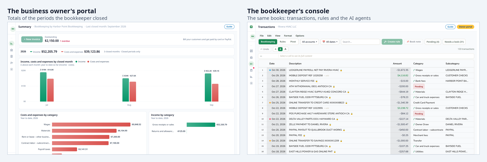
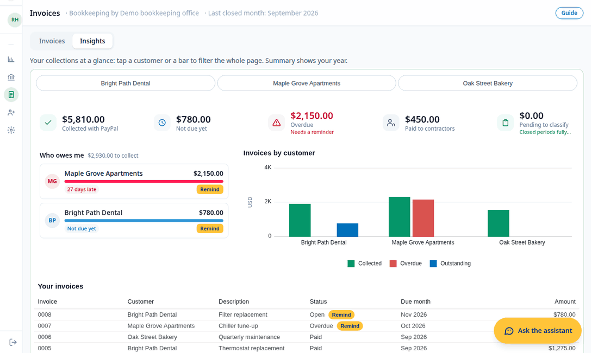

# ContaBu — a guide for judges

**We want PayPal to become the main account of small businesses, where they get paid, invoice and pay, and to reach them
through the bookkeeper who already keeps their books.** The tools to accept cards exist, but 76% of US construction
subcontractors are usually or always paid by paper check
([PYMNTS Intelligence, 2024](https://www.pymnts.com/report/tracker/from-the-ground-up-rebuilding-payments-in-the-construction-industry/)).
ContaBu reaches the owner through their bookkeeper: an office keeps their books in a console built for many businesses
and gives each owner a portal with PayPal at its center. Across the product, the AI prepares, the code checks and a
person confirms.

The demo is at [paypal.contabu.com](https://paypal.contabu.com): a tour with no account, or your own book with the
access code. The steps to test it are in [TESTING.md](TESTING.md), and the project's limits at the end of the
[README](../README.md). Everything runs in PayPal's sandbox.

## Before and during the hackathon

ContaBu existed before the submission period: since June 14, 2026 it was a prototype with bank statements, a rules
engine and the profit and loss statement computed in SQL, in which the AI still assigned the categories. Since October 1
we built what is presented here: the bookkeeper's console for many client books and its team of AI agents, and
everything PayPal: the owner's portal, seven PayPal APIs, the Agent Toolkit and the AG Studio dashboard. The public
commit history keeps the dates, and the [CHANGELOG](CHANGELOG.md) tells the whole story in a single table, with a line
that marks the start of the period.

## Technological implementation

ContaBu uses seven PayPal APIs to cover the whole cycle of a small business's money, from the invoice to the payment and
from the payment to the books. When a customer pays, the webhook doesn't take the notice at its word: it has PayPal
verify the signature on the original bytes and re-reads the invoice, so every payment, partial or final, enters for its
own amount and no PayPal movement is booked twice. The AI works within those same limits: it touches PayPal at three
points and executes at none. It prepares the draft of a dictated invoice, writes the message of a reminder and sums up in
plain words what the customer claims in a dispute; sending, reminding, canceling and replying are done by the code when
the owner taps the button. From the PayPal Agent Toolkit we use its definitions and its permission model, but not its
functions, because reading the package we found that its `create_invoice` sends the invoice right away; so the model
only returns data and the code is what builds, validates and executes. The two tables sum up what each API is used for
and what each model does, with what we measured; the detail (the webhook, the Toolkit, how we chose the models and what
PayPal taught us) is in [its own document](judges/technological-implementation.md).

**Result: the webhook was verified on the deployed site with the payment of a sandbox invoice, and 14 checks with their
published output back up the rest, among them 147 routes tried with every role, with no leaks ([TESTING.md](TESTING.md)).**

| PayPal API | What ContaBu uses it for |
|---|---|
| Invoicing v2 | Drafts, sending, reminders, QR code, recurring invoices, next invoice number and payments recorded outside PayPal |
| Webhooks | Booking each payment of an invoice as soon as it arrives |
| Transaction Search | Bringing sales, fees, refunds, withdrawals and purchases into the books |
| Balances | Comparing the PayPal balance with what the books add up to |
| Disputes | Seeing and answering customers' claims |
| Payouts | Paying contractors from the PayPal balance |
| Log in with PayPal | Connecting the business account |

| AI use | Model | What the AI does and what the code does | Measured |
|---|---|---|---|
| Dictated invoice | NVIDIA Nemotron 3 Nano | The code hides the customer's name; the AI returns the amount, the description and the parts of the date; the code validates and fills the draft | 195 of 200 correct (100 dictations in English and Spanish, run twice); in the other 5 the model gave no answer or no due date, and the code said so instead of guessing · 0.4–2.7 s · ~$0.00005 |
| Payment reminder | NVIDIA Nemotron 3 Nano | The code picks the tone; the AI writes with placeholders; the code fills in the name, the amount and the link | 0.8–1.2 s · ~$0.00005 |
| Dispute summary | NVIDIA Nemotron 3 Nano | The AI sums up what the customer claims, without seeing names, contact details or amounts; the owner decides how to reply | — |
| Dashboard assistant | Qwen3 235B, [chosen by measuring](judges/technological-implementation.md) | The figures come from SQL; the AI writes the answer; the code checks every figure before showing it | [In Best use of AG Grid](#best-use-of-ag-grid) |
| The bookkeeper's agents | NVIDIA Nemotron, with Tavily web searches | They review the books and propose rules; the bookkeeper approves them | [In Potential impact](#potential-impact) |

## Design

ContaBu is a product with two doors to the same books, one for each person who runs the business, in English and
Spanish, on desktop and on phone. The owner enters a portal with four windows (Summary, their year from the closed
periods; Accounts, the PayPal balance next to what the books add up to; Invoices, with reminders, QR code, disputes and
the Insights tab; and Contractors, the payments with Payouts), and the bookkeeper works in a console with the sheet, the
rules, the banks, the month-end close and the agents' review. The separation doesn't depend on the interface: each role
has its list of allowed routes on the server, and [the permission check](TESTING.md) proves it on every route. The owner
never sees a transaction, only the totals of the months their bookkeeper closed, which no rule, edit or bank update can
change; what is still pending is declared instead of hidden, and the bookkeeper can see the portal "as the owner" before
publishing anything to them.

The journey closes on itself: the owner dictates an invoice from a phone and reviews it, their customer pays it by card,
the payment enters the books with its fee apart, the bookkeeper closes the month and the owner sees that month in their
Summary. Trust is built in plain sight: nothing is sent without a review screen, and every AI step has a "What the AI
did" panel that shows what the model read, what the code filled, what it checked, how long it took and what it cost,
built from the same row that records each call. We reviewed the product as a customer would and fixed what got in the
way: the assistant went from taking half the screen to a floating window, the Invoices cards filter the list, and the
dashboard swaps the customer buttons for a search box when there are more than six, groups under "Others" those who are
not among the ten who invoiced the most, and shows the five most urgent in "Who owes me". We tested it with 3 and with 30
customers, on desktop and on phone.

**Result: a judge walks through the whole product in a [fourteen-stop tour](TESTING.md), without creating an account,
and on every screen sees only what belongs to that person and what the AI did.**

## Potential impact

**The problem.** What businesses offer doesn't match how their customers pay: almost a third (30%) of US small
businesses don't offer both cash and card, even though 89% of consumers pay by card and 74% still use cash
([Xero, 2024](https://www.xero.com/us/media-releases/xero-data-reveals-mismatch-in-payment-preferences-us/)). And
getting paid is getting harder: 59% of small businesses have invoices 30 days or more past due
([Intuit QuickBooks, 2026](https://quickbooks.intuit.com/r/small-business-data/small-business-late-payments-report-2026/)).
The person who built ContaBu works as a bookkeeper in the United States, and what that work shows is that the plumber, the electrician and the builder know their trade, but nobody they trust has put the tool in their hands; the
fee is the objection heard most, and ContaBu shows it before the invoice is sent and books it apart. And those who do get
paid with PayPal suffer it in the books: PayPal pays net, so every sale has to be rebuilt from its gross and its fee, the
withdrawal to the bank looks like new income and a purchase paid with PayPal shows up twice.

**The channel, and why it will matter more.** The owner already has someone they trust: 86% agree that their accountant
is a trusted advisor (53% strongly agree and 33% agree;
[OnPay, 2019](https://onpay.com/insights/2019-small-business-finance-hr/), which says "accountant", not "bookkeeper").
And that channel will weigh more: bookkeeper employment is projected to
[fall 6% from 2025 to 2035](https://www.bls.gov/ooh/office-and-administrative-support/bookkeeping-accounting-and-auditing-clerks.htm),
and the
[71,408 bookkeeping and non-CPA accounting offices, with four employees on average](https://data.bls.gov/cew/data/api/2024/a/industry/541219.csv)
(BLS, 2024), will serve 36.4 million businesses. Hispanic-owned businesses keep growing: Hispanic-owned employer
businesses went from 406,086 in 2021 to 496,000 in 2023, and construction is their top sector; in addition, 5.3 million
businesses without employees are Hispanic-owned, which is why ContaBu is complete in English and Spanish
([Census Bureau, 2024](https://www.census.gov/library/stories/2024/10/hispanic-owned-businesses.html);
[2025](https://www.census.gov/newsroom/press-releases/2025/business-owner-characteristics.html)).

**What changes.** ContaBu gives the office a console for many clients, where every PayPal sale enters the books the way
a bookkeeper would record it: the gross as income, the fee as an expense, the refund subtracting from income and the
withdrawal off the profit and loss statement, matched to its bank deposit, like every purchase to its charge. The
bookkeeper's rules run first and then PayPal's event code; what neither covers stays pending and is declared in every
figure, and the bank matching acts on its own only when there is no doubt. Through that console, each owner gets a
portal to invoice, take cards even when their customer has no PayPal account, send reminders, collect with a QR code and
pay their contractors with Payouts, with the fee visible before sending. PayPal's invoice payment page already offers [Pay Later](https://www.paypal.com/us/business/accept-payments/installment-payments): the customer can pay in four installments or monthly, and the owner gets the full amount up front. ContaBu didn't build it; it gets it because every invoice goes out through PayPal. The owner gets the tools of a big company, and
their money can stay in PayPal. What the demo shows is one complete business, from the dictated invoice to the closed
month. The console already keeps several books per office, and the bookkeeper moves from one to another from their list
of clients, but the public demo seeds only one: the channel of many businesses is what we argue, not what the demo
shows.

**What is missing and what comes next.** To connect other businesses' accounts, ContaBu needs PayPal to approve it as a
partner (Partner Referrals); we tried it in the sandbox with six combinations of permissions and they all answer that
the app is not authorized, so the demo connects the business's own sandbox app. Next is applying for that approval,
taking contractor payments to production with the yearly summary per contractor, and reconciling the PayPal balance with
the books continuously, with an alert when they drift apart. Later on, a business that is just starting could use the
same portal on its own and move to a bookkeeper as it grows.

**Result: the bookkeeper saves time, because a paid invoice enters the books on its own, with its fee apart, and the
full review of a real book of 197 transactions (January to October 2026) by the AI agents takes 31 to 34 seconds and
costs $0.007 to $0.008, measured with `backend/measure.py` and `backend/team_matrix.py`.**

## Innovation / Idea

Two ideas set it apart from what already exists. QuickBooks, Xero and Wave also send invoices that are paid by card, but
they are designed for the owner to use on their own; ContaBu reaches the owner through their bookkeeper, with a single
set of books for both, and so PayPal enters the business as part of the bookkeeping it already has. And the obvious move
in bookkeeping and payments is to let the AI decide; we did the opposite: the AI never computes, never categorizes and
never sends, and each of those limits lives in the code, not in an instruction to the model.

The figures come from SQL: the assistant's tools return totals, rankings, highs and lows already computed; on every new
question, the model is required to query before answering; and before the answer is shown, the code looks up every
amount it wrote in the results of those queries (`backend/studio_ai.py`). If any is missing, the answer is replaced by a
notice. That is how we got every test question right ([Best use of AG Grid](#best-use-of-ag-grid)), in three rounds: in
the first, three of ten failed, because the months were stored as text; in the second, the model added on its own, got
it wrong and the check hid the answer; in another, it answered without querying and made up figures, and since then it
is required to query.

The category of each transaction is set by a rule or the bookkeeper, and sending an invoice, a reminder or a payment is
always the owner's action: the dictation model gets no tools, the assistant only has tools that read or filter, and the
PayPal Agent Toolkit's permission model keeps sending, reminding and canceling out of an AI's reach. "Send it now" in a
dictation leaves the draft for review, and "send them a reminder right now" to the assistant opens Invoices. Each model
gets only what it needs: in dictation, the code replaces the customer's name with `[CUSTOMER]` before calling the model,
and if it recognizes nobody it doesn't call it (`backend/check_voice.py` checks that the name appears in no call); in
reminders, the code picks the tone from the payment history and the model writes with placeholders, without seeing
names or amounts. And what the AI does stays in view: every step has a panel with what it did, what the code checked,
its time and its cost, built from the record of each call and not from a separate text.

In the books, the same idea was measured in October with blind exams, with the errors hidden and the answers out of the
agents' reach: the agents judge and the bookkeeper decides. Of 22 hidden errors, the agents on NVIDIA Nemotron found 14
to 15, against 8 for the code without AI; on a real book of 197 transactions, of 12 errors hidden by a bookkeeper, the
code alone found none and the agents 7. The scripts for those measurements are in this repository, `backend/measure.py`
and `backend/team_matrix.py`.

**Result: the code hid the three answers with made-up figures that the model wrote in testing, so the owner never saw a
false figure.**

## Presentation

The [video](https://www.youtube.com/watch?v=bHiJpu7pj20) shows the product from start to finish in 2:46, narrated with an AI clone of the author's voice.
Its chapters are in its YouTube description and here, each one linked to its minute:

- [0:00 ContaBu in 20 seconds](https://www.youtube.com/watch?v=bHiJpu7pj20&t=0s)
- [0:23 The problem, and why English and Spanish](https://www.youtube.com/watch?v=bHiJpu7pj20&t=23s)
- [0:44 Two doors to the same books](https://www.youtube.com/watch?v=bHiJpu7pj20&t=44s)
- [0:57 Get paid by card, or over time](https://www.youtube.com/watch?v=bHiJpu7pj20&t=57s)
- [1:20 Every invoice in order, and an AI assistant that can't make up figures](https://www.youtube.com/watch?v=bHiJpu7pj20&t=80s)
- [1:51 No bookkeeping to do](https://www.youtube.com/watch?v=bHiJpu7pj20&t=111s)
- [2:12 The bookkeeper sees it all](https://www.youtube.com/watch?v=bHiJpu7pj20&t=132s)
- [2:33 Try it](https://www.youtube.com/watch?v=bHiJpu7pj20&t=153s)

The guided tour (the
**Guide** button, at the top right) explains each result on the screen where it lives. The repository includes this
document, [TESTING.md](TESTING.md) with the output of every check, the [CHANGELOG](CHANGELOG.md) with what was built
during the hackathon and when, and the commit history since June 14, 2026.

## Best use of AG Grid

The Insights tab, inside Invoices, is an AG Studio dashboard over the business's invoices, contractor payments and
closed periods. We wrote three widgets inside the canvas: "Who owes me" shows each customer with what they owe, the
overdue part, the days late and a button to remind them; the indicators show each figure with an icon and a color for
good or bad, and one declares what is pending categorization; and the search box replaces the customer buttons when
there are more than six. Each widget is registered with `createWidgets`, asks for its data with `widgetApi.getData` over
rows the code already computed and filters with `toggleCrossFilter`; the search box reads the selection with
`getCrossFilterSelections`, so its label always matches the filter (`studioWidgets.tsx`). AG Studio's native table shows
a "Remind" button on each unpaid invoice, drawn with `createCellRenderer`, with the invoice's id and status brought in by
`getLinkedFields`; it sends nothing, but takes the owner to the invoice, and with the "Overdue" card two taps are enough
to reach the reminder of an overdue invoice. It is close to the *nudge-bot* the prize page suggests: who still owes and
a friendly reminder, which the owner reviews before sending.

The dashboard uses the portal's colors, typography and borders through `studioTheme.withParams`, with a 24-column layout
and a layout of its own for narrow screens (`responsiveLayoutBreakpoints`), and shows the categories, statuses and months
in the screen's language. The Summary charts, the owner's first screen, moved to AG Charts (`ag-charts-community`, the
library AG Studio runs on) with a single palette for both screens, validated for color blindness and contrast
(`yearCharts.tsx`), so everything reads as one product; the charts that repeated the Summary left the dashboard, and what
remains filters together. How it behaves with many customers is in [Design](#design).

On top of that dashboard we built an assistant with AG Studio's Agent Framework and a swapped-in harness of our own
(`createAiHarness`). Our adapter (`AgLlmAdapter`) takes each turn to our server: the tools that return figures are
declared as `server`, the server runs them in SQL and loops with the model until it has the answer, up to four rounds,
and checks every figure before returning it ([Innovation](#innovation--idea)). It also uses AG Studio's own tools: it
sees the dashboard's schema and widgets, queries it with its data engine and filters it (`viewSchema`, `viewReport`,
`executeQuery`, `addPageFilter`), so it can show the owner on the dashboard what it is telling them. Because AG Studio's
chat only exists in edit mode, and returning to view mode rearranged the widgets, the harness is built in `onApiReady`
and connected to a floating chat of our own, with the dashboard always in view mode and mounted even when hidden, so the
assistant answers on any screen and keeps the conversation (`studioAssistant.ts`, `OwnerChat.tsx`,
`backend/studio_ai.py` and `backend/studio_tools.py`). The SQL queries take 1 to 8 milliseconds locally and 84 to 137 on
the deployed site.

What we learned from AG Studio: its query tools have a large, nested schema, small models couldn't fill it, and each
turn weighs about 12,000 tokens because the whole schema travels with it; when the model asks for a `server` tool, AG
Studio gives it a placeholder result and calls it again, which is why that loop lives on our server; and its list filter
is a vertical list, not a search box, so for many customers we wrote our own.

**Result: a dashboard with three widgets of our own, the portal's theme and a table with actions, and on top of it an
assistant with a swapped-in harness on the Agent Framework, which uses Studio's tools and answered 10 of 10 questions
correctly, in 1.7 to 3.4 seconds per one-part question on the deployed site with the server already running, and for
about $0.005 each.**
